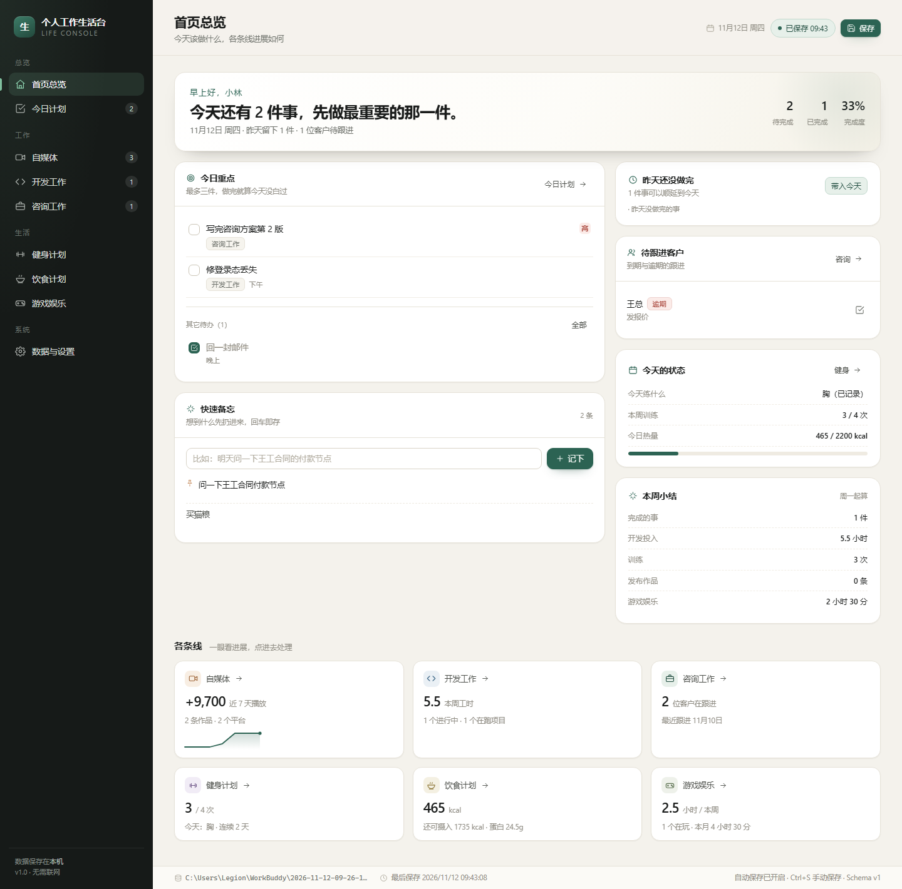
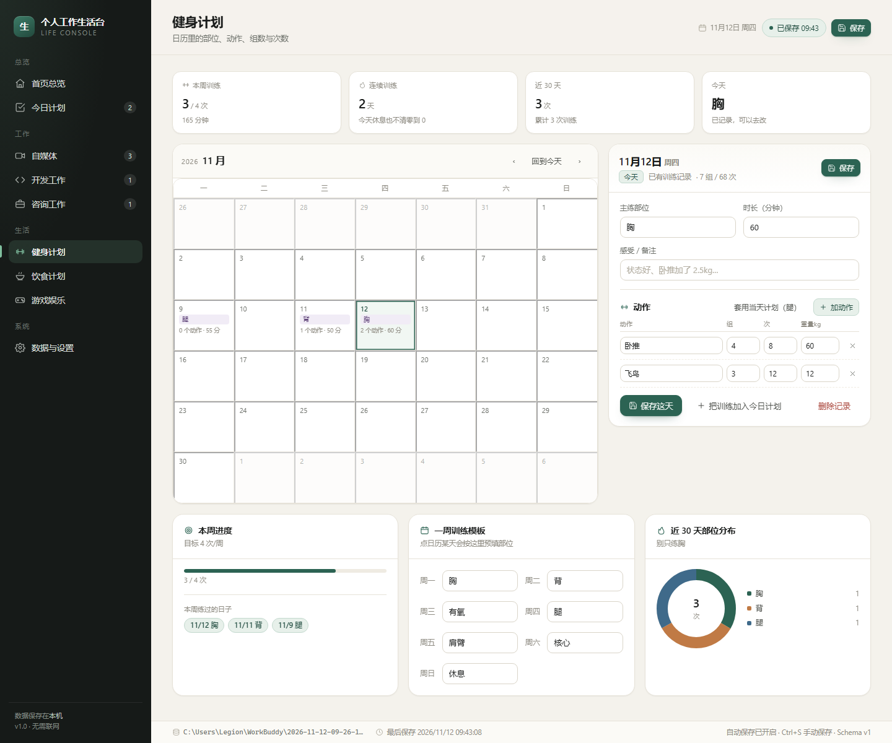
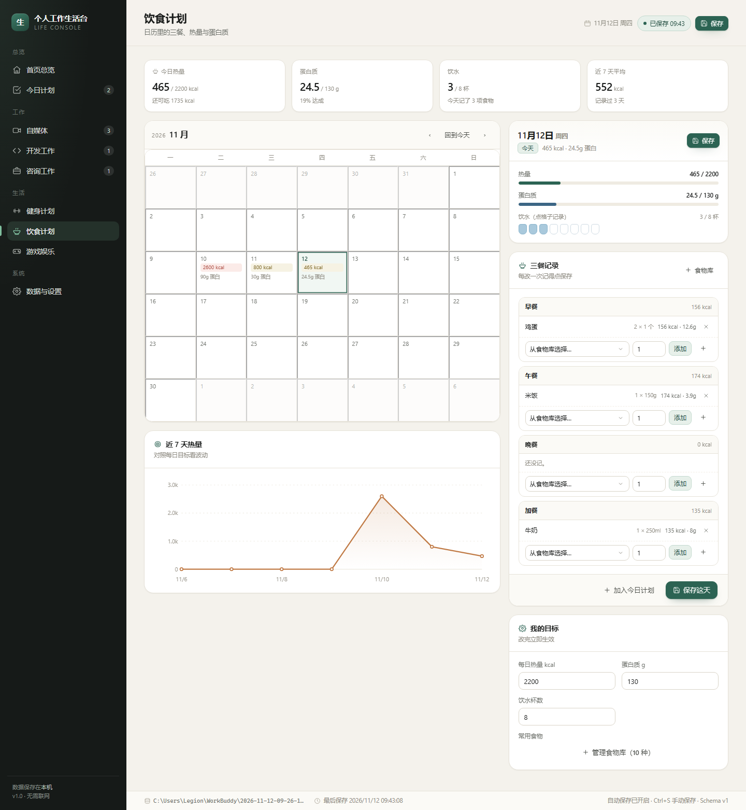
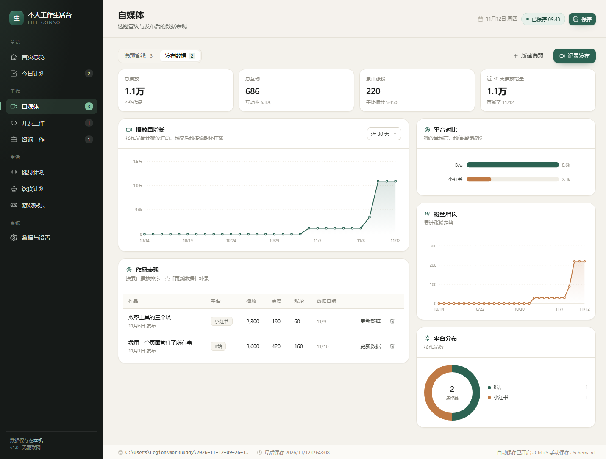

# 个人工作生活台（myapp）

一个只在自己电脑上运行的个人工作 / 生活一体化工作台。左边九个入口，把**今天要做的事、吃饭、睡觉、练腿、写代码、接客户、发视频、打游戏**放进同一个页面，数据真实写在本地文件里。

不需要登录、不需要联网、没有云数据库，也不会上传到任何服务器。



---

## 它解决什么问题

一个人同时有工作、副业、客户、身体和娱乐，信息散在待办 App、备忘录、Excel、日历和脑子里，结果是：

- 早上坐下来不知道先干哪件；
- 客户说「下周再聊」，然后就忘了；
- 视频发出去只看一眼播放量，不知道哪个平台值得继续做；
- 健身和吃饭全凭感觉，一个月后想不起来练了什么、吃了多少；
- 待办工具很多，但没有一个能同时装下「工作」和「生活」。

这个项目把这些收进一个本地页面：**每天打开首页就知道今天该做什么，每个模块只做它该做的事，数据始终在自己硬盘上。**

---

## 主要功能

| 模块 | 你能做什么 |
| --- | --- |
| **首页总览** | 今日完成度、三件重点、快速备忘（回车即存）、6 个模块摘要、待跟进客户、本周小结；昨天没做完的事可一键带入今天 |
| **今日计划** | 按上午 / 下午 / 晚上分组管任务，设三件重点、改优先级、勾完成、顺延到明天、查看任意一天 |
| **自媒体** | 选题五阶段看板（选题 → 脚本 → 拍摄 → 剪辑 → 已发布）；发布记录与数据快照；播放增长曲线、平台对比、粉丝增长、作品排行 |
| **开发工作** | 项目 → 工作项（功能 / 缺陷 / 重构 / 杂务）→ 工时日志；状态流转、预估与实际工时、本周工时分布、状态占比 |
| **咨询工作** | 客户全生命周期（线索 → 沟通 → 签约 → 交付 → 结束 / 流失）、项目金额与周期、沟通纪要与下次跟进、月度成交金额 |
| **健身计划** | 月历按天记录：练什么部位、哪些动作、几组、几次、多重；周训练模板、连续训练天数、30 天部位分布 |
| **饮食计划** | 月历按天记录三餐与加餐，自动算热量和蛋白质并对比每日目标；常用食物库、饮水打卡、近 7 天热量曲线 |
| **游戏娱乐** | 游戏 / 剧集清单（在玩 / 想玩 / 已通关 / 弃坑）、评分、游玩时长记录、近 4 周时长与时间去向 |
| **数据与设置** | 手动保存、立即备份、从备份恢复、导出 / 导入 JSON、按模块清空、昵称与各项目标、数据统计 |

界面示意（示例数据）：

| 健身日历 | 饮食日历 |
| --- | --- |
|  |  |

| 自媒体数据 |
| --- |
|  |

---

## 技术选择（为什么这么简单）

- **零运行时依赖**：服务端只用 Node 内置 `node:http` 与 `node:fs`，前端是原生 ES Modules + 手写 SVG 图表，没有框架、没有构建步骤、没有 CDN。断网、换电脑、一年后回来都能跑。
- **数据落盘可靠**：先写 `app-data.json.tmp`，`fsync` 后原子重命名，断电不会留下半个文件；每天第一份数据自动留一份备份。
- **服务只监听 `127.0.0.1`**：局域网其它设备访问不到。
- **业务逻辑与界面分离**：日期计算、统计聚合、图表几何都在 `public/js/core` 与 `components` 里，可在 Node 中直接测试。

目录结构：

```
myapp/
├─ server/            # 本地服务：静态资源 + 数据 API（无依赖）
│  ├─ index.js
│  └─ store.js        # 原子写入、每日备份、恢复、校验
├─ public/
│  ├─ index.html
│  ├─ styles/app.css  # 设计系统（CSS 变量 + 组件类）
│  └─ js/
│     ├─ app.js       # 路由、状态、自动/手动保存
│     ├─ api.js
│     ├─ core/        # 数据模型、日期、统计（纯逻辑）
│     ├─ components/  # UI、图表、日历
│     └─ views/       # 9 个模块页面
├─ tests/             # node:test 用例（73 项）
├─ data/              # 运行后生成，已被 git 忽略
├─ start.bat / start.sh
├─ PRD.md / PLAN.md
└─ README.md
```

---

## 安装方法

### 环境要求

- **Node.js 20 或更高版本**（开发验证于 v22.22）
- 任意现代桌面浏览器（Edge / Chrome / Firefox）

检查是否已安装：

```bash
node -v
```

没有的话去 <https://nodejs.org/> 下载 LTS 版本安装即可。

### 获取代码

```bash
git clone <你的仓库地址> myapp
cd myapp
```

或直接下载 ZIP 解压。**不需要 `npm install`**（没有依赖）。

---

## 使用方法

### 启动

- **Windows**：双击 `start.bat`（会自动打开浏览器）
- **macOS / Linux**：`chmod +x start.sh && ./start.sh`（会自动打开浏览器）
- 或者命令行：`npm start`，然后手动访问 <http://127.0.0.1:4173>

关闭那个命令行窗口即停止服务。

> 端口被占用时：`PORT=4174 npm start`（Windows PowerShell：`$env:PORT=4174; npm start`）。

### 每天怎么用

1. 打开首页，看「今日重点」和「待跟进客户」。
2. 在「今日计划」写今天要做的事，挑三件点亮星标。
3. 各模块按需记录：自媒体记发布与数据、开发记工作项与工时、咨询记沟通与下次跟进。
4. 健身、饮食直接点日历上的某一天，填当天的动作或三餐。
5. 改完不用刻意保存——700ms 后自动写入；想立刻存就点右上角「保存」或按 `Ctrl + S`。
6. 至少每周点一次「数据与设置 → 立即备份」。

### 快捷键

| 快捷键 | 作用 |
| --- | --- |
| `Ctrl / Cmd + S` | 手动保存（不会弹出浏览器保存网页窗口） |
| `Esc` | 关闭弹窗 |

### 保存与备份

- 顶栏常驻**保存状态**：已保存 / 有未保存修改 / 保存中 / 保存失败。失败会变红并说明原因，数据仍留在内存里。
- 切换模块、关闭页面、切到后台都会兜底保存。
- 数据文件：`data/app-data.json`
- 备份目录：`data/backups/`（自动备份每天一份，保留 30 天；手动备份不自动清理）
- 恢复前会自动生成一份 `pre-restore-*.json`，恢复错了还能退回来。

---

## 输入输出示例

### 输入 1：加一条今日任务

在「今日计划」输入框写：

```
写完咨询方案第 2 版
```

选「高优先 / 上午」，回车。首页立刻出现这条重点候选，`data/app-data.json` 里多出：

```json
{
  "id": "task_m3k9x1a",
  "title": "写完咨询方案第 2 版",
  "note": "",
  "module": "today",
  "refId": "",
  "priority": "high",
  "slot": "morning",
  "done": false,
  "date": "2026-11-12",
  "createdAt": "2026-11-12T01:20:31.442Z"
}
```

### 输入 2：记一次训练

「健身计划」点 11 月 12 日 → 主练部位填「胸」→ 加动作「卧推 / 4 组 / 8 次 / 60kg」→ 保存这天。日历格子里立刻显示「胸 · 2 个动作 · 60 分」，`fitness.sessions` 中新增：

```json
{
  "id": "workout_m3k9y2b",
  "date": "2026-11-12",
  "focus": "胸",
  "durationMin": 60,
  "exercises": [
    { "id": "ex_m3k9z3c", "name": "卧推", "sets": 4, "reps": 8, "weight": 60 }
  ]
}
```

### 输入 3：补录视频数据

「自媒体 → 记录发布」，填标题、平台、发布日期，再填当前播放 8600、点赞 420、涨粉 160。系统会写入一条当日快照：

```json
{
  "id": "post_m3ka14d",
  "title": "我用一个页面管住了所有事",
  "platform": "B站",
  "publishedAt": "2026-11-01",
  "snapshots": [
    { "date": "2026-11-12", "views": 8600, "likes": 420, "comments": 55, "followers": 160 }
  ]
}
```

隔几天再更新一次，就会多一条快照，播放增长曲线随之变化；只更新最新值也不会把历史冲掉。

### 输出 1：导出的数据文件

「数据与设置 → 导出全部数据」下载 `app-data-2026-11-12.json`，结构如下（省略部分内容）：

```json
{
  "version": 1,
  "meta": { "createdAt": "2026-11-01T00:12:03.001Z", "updatedAt": "2026-11-12T01:34:10.221Z", "appName": "个人工作生活台" },
  "settings": { "nickname": "小林", "fitnessWeeklyGoal": 4, "calorieTarget": 2200, "proteinTarget": 130, "waterTarget": 8 },
  "today": { "tasks": [], "memos": [], "focus": [] },
  "content": { "ideas": [], "posts": [], "platforms": ["抖音", "B站", "小红书", "视频号", "公众号"] },
  "dev": { "projects": [], "items": [], "logs": [] },
  "consulting": { "clients": [], "projects": [], "sessions": [] },
  "fitness": { "weekdayPlan": { "1": "胸", "2": "背", "3": "有氧", "4": "腿", "5": "肩臂", "6": "核心", "0": "休息" }, "sessions": [] },
  "diet": { "foods": [], "days": [] },
  "games": { "items": [], "sessions": [] }
}
```

这份文件可以直接用来换电脑：在新机器上启动后「从 JSON 文件导入」即可。

### 输出 2：备份文件

点「立即备份」后生成 `data/backups/manual-20261112-095123.json`，内容与上面的导出文件一致；备份列表里会显示文件名、类型、大小和时间，点「恢复」需要二次确认。

### 输出 3：接口返回

```bash
curl http://127.0.0.1:4173/api/state
```

```json
{
  "state": { "version": 1, "today": { "tasks": [] }, "...": "..." },
  "savedAt": "2026-11-12T01:34:10.221Z",
  "size": 12873,
  "revision": 12,
  "dataFile": "C:\\Users\\you\\myapp\\data\\app-data.json",
  "backupDir": "C:\\Users\\you\\myapp\\data\\backups"
}
```

---

## 测试

```bash
npm test
```

当前 **73 项用例全部通过**，覆盖：

- 日期与月历矩阵（42 格、周一起始、跨年、跨月）
- 各模块统计聚合（内容快照、工时、客户阶段、热量、训练、游戏时长）
- 图表几何（空数据、全 0、单点、超目标不溢出、不出现 NaN）
- 数据模型规范化与导入校验（字符串数组不被清空、非法数据不覆盖原文件）
- 服务端 API（保存、原子写入、每日备份、恢复、导出、路径穿越防护、损坏文件恢复）
- 9 个页面在「有数据 / 空数据」下的渲染完整性与标签闭合
- 全量 JS 语法检查、离线检查（无 CDN / 外链字体）、导航跳转目标有效性

---

## 常见问题

**数据会丢吗？**
数据写在硬盘文件里，不在浏览器缓存中。清浏览器缓存、换浏览器都不影响。机器坏了属于另一回事——所以请定期备份或导出。

**换电脑怎么办？**
旧电脑导出 JSON → 新电脑启动后导入。

**能不能手机用？**
第一版不做，界面按桌面浏览器（1280px 以上）设计。

**会不会联网？**
不会。页面、脚本、图表全部本地，服务只监听 `127.0.0.1`。

**想清空重来？**
「数据与设置 → 危险操作」可以按模块清空；也可以直接删掉 `data/` 目录（会连备份一起删，谨慎）。

**数据文件被手动改坏了？**
启动时若解析失败，会把坏文件改名成 `app-data.json.corrupt-时间戳` 保留，再以空数据启动；可以从 `data/backups/` 恢复。

---

## 已知限制（第一版不做）

登录与多用户、云同步、手机端、第三方平台数据自动抓取、附件与图片上传、提醒推送、Excel / PDF 报表导出、主题切换、数据加密。

产品范围与验收标准见 [PRD.md](PRD.md)，开发计划见 [PLAN.md](PLAN.md)。
